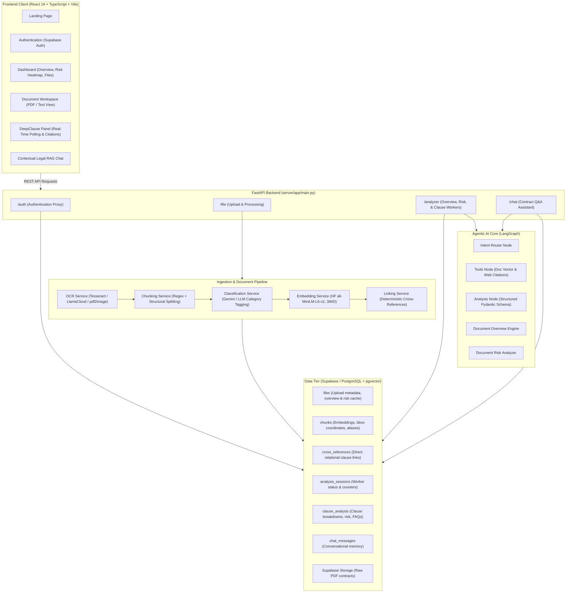
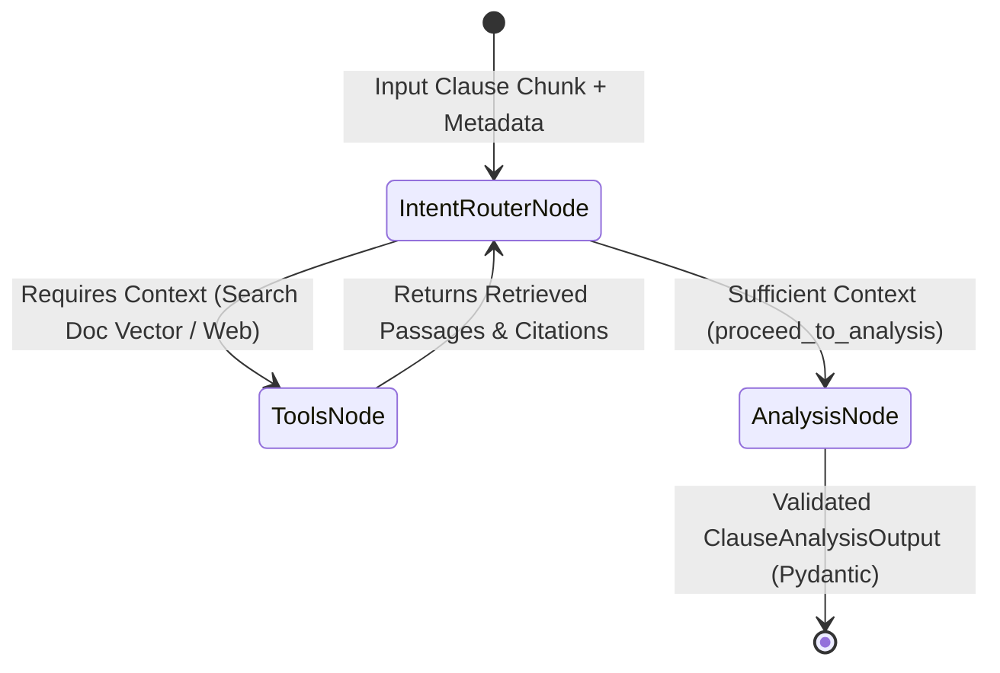

# Legalyze — AI-Powered Contract Intelligence & Clause Analysis Platform

> **Legalyze** (Project PID-25) is an end-to-end legal intelligence platform designed to decode complex legal contracts. It transforms multi-page agreements into clear, structured, and risk-assessed insights using **OCR extraction**, **deterministic cross-reference linking**, **semantic vector embeddings (`pgvector`)**, and autonomous **LangGraph-driven clause review agents**.

---

## 📑 Table of Contents
1. [Overview & Core Features](#overview--core-features)
2. [System Architecture](#system-architecture)
3. [DeepClause Multi-Agent Architecture](#deepclause-multi-agent-architecture)
4. [Tech Stack](#tech-stack)
5. [Database Schema (`PostgreSQL + pgvector`)](#database-schema-postgresql--pgvector)
6. [Prerequisites](#prerequisites)
7. [Installation & Setup Guide](#installation--setup-guide)
   - [Database Setup](#1-database-setup-supabase)
   - [Backend Setup (FastAPI)](#2-backend-setup-fastapi)
   - [Frontend Setup (React + Vite)](#3-frontend-setup-react--vite)
8. [Environment Configuration Reference](#environment-configuration-reference)
9. [API Endpoints Overview](#api-endpoints-overview)
10. [Folder Structure](#folder-structure)
11. [Troubleshooting & FAQ](#troubleshooting--faq)

---

## 🚀 Overview & Core Features

- **Document Ingestion & OCR**: Supports scanned contracts, legal agreements, and PDFs with bounding-box metadata for visual citation highlights.
- **Hierarchical Clause Segmentation & Classification**: Segments long contracts into individual clauses, detects section aliases (e.g., *"Section 4.1"*, *"Article 12"*), and categorizes them (*Financial, Termination, Indemnity, Liability, Confidentiality*).
- **Deterministic Cross-Reference Engine**: Automatically maps internal references (e.g., *"subject to Section 9.2"*) directly to their corresponding clauses in the database.
- **DeepClause LangGraph Analysis**:
  - Plain-English breakdown for non-lawyers.
  - Risk grading (**LOW**, **MEDIUM**, **HIGH**) with transparent rationales.
  - Identification of parties, obligations, and liabilities.
  - Real-world hypothetical conflict scenarios.
  - Strategic counter-offer & negotiation guidance.
  - Clause-specific FAQs.
- **Document-Level Risk & Summary**: Generates high-level contract executive summaries and risk heatmaps before diving into individual clauses.
- **Interactive Contract RAG Chat**: Context-grounded conversational assistant that answers specific questions referencing verified contract clauses.
- **Live Session Tracking**: Asynchronous clause analysis with atomic session status polling for real-time progress visualization on the frontend.

---

## 🏛️ System Architecture



---

## 🧠 DeepClause Multi-Agent Architecture

The clause evaluation engine is built using **LangGraph** ([graph.py](file:///a:/Pid25/Final-year-project-pid-25/server/app/Agents/Clause_Analyisis_Agent/graph.py)). Rather than making a single zero-shot prompt, an autonomous agent inspects each clause, checks whether external definitions or linked sections are needed, and aggregates the evidence.



1. **Intent Router Node**: Evaluates if the current clause refers to undefined terms, financial schedules, or cross-referenced articles.
2. **Tools Node**: Executes semantic vector search against other contract chunks (`pgvector`) or retrieves external statutory references.
3. **Analysis Node**: Synthesizes the aggregated context into a strictly validated schema containing plain-English explanations, risk level, counter-proposals, and FAQs.

---

## 🛠️ Tech Stack

### Frontend
- **Framework**: React 19 (TypeScript) with Vite
- **Styling**: TailwindCSS 4, Custom warm-parchment legal design system
- **Routing & State**: React Router DOM v7
- **Icons & Markdown**: Lucide React, `react-markdown`, `remark-gfm`
- **PDF Rendering**: `pdfjs-dist`

### Backend
- **Framework**: FastAPI (Python 3.10+)
- **Agent Orchestration**: LangGraph, LangChain
- **LLM Providers**: Groq (`openai/gpt-oss-20b`, `llama3.3-70b-versatile`) or Ollama (`llama3.1:latest`)
- **Embeddings**: HuggingFace `sentence-transformers/all-MiniLM-L6-v2` (384 Dimensions)
- **Document Parsing & OCR**: LlamaCloud, Tesseract, pdf2image

### Database & Storage
- **Database**: PostgreSQL with `pgvector` extension hosted on Supabase
- **Object Storage**: Supabase Storage Buckets (for raw PDF files)
- **Authentication**: Supabase Auth

---

## 🗄️ Database Schema (`PostgreSQL + pgvector`)

The project uses a normalized schema with vector search capabilities ([database_schema.sql](file:///a:/Pid25/Final-year-project-pid-25/server/database_schema.sql)):

| Table Name | Description | Key Fields |
|---|---|---|
| `files` | Tracks uploaded documents & cached document-level intelligence | `id`, `user_id`, `file_name`, `file_url`, `status`, `overview_cache`, `risk_cache` |
| `classifications` | Legal category taxonomy | `id`, `name` (*Financial, Termination, Indemnity, etc.*), `description` |
| `chunks` | Segmented contract clauses with dense embeddings & coordinates | `id`, `document_id`, `text`, `aliases` (*"Article 4.1"*), `bbox`, `embedding VECTOR(384)` |
| `cross_references` | Deterministic links between related clauses | `source_chunk_id`, `target_chunk_id`, `reference_text`, `match_type` |
| `analysis_sessions` | Progress tracking state machine for clause analysis | `document_id`, `total_clauses`, `completed`, `failed`, `in_progress`, `status` |
| `clause_analysis` | DeepClause outputs per chunk | `chunk_id`, `document_id`, `explanation`, `risk_level`, `risk_analysis`, `negotiation_advice`, `faqs`, `citations` |
| `chat_messages` | Contextual conversational memory for RAG chat | `id`, `document_id`, `user_id`, `role`, `content` |

---

## ⚙️ Prerequisites

Make sure the following are installed on your machine:
- **Node.js** (v18.0.0 or higher) and **npm**
- **Python** (v3.10 or v3.11 recommended)
- **Git**
- A **Supabase account** (or local Supabase instance)
- A **Groq API Key** (or local **Ollama** running)
- *(Optional)* **Tesseract OCR** (if running local OCR parsing)

---

## 📦 Installation & Setup Guide

### 1. Database Setup (Supabase)
1. Go to your [Supabase Dashboard](https://supabase.com/dashboard) and create a new project.
2. Open the **SQL Editor** in your Supabase dashboard.
3. Copy and run the entire contents of [server/database_schema.sql](file:///a:/Pid25/Final-year-project-pid-25/server/database_schema.sql).
   - This enables the `vector` extension and creates all required tables, foreign keys, and performance indexes.
4. Go to **Storage** in Supabase and create a public or authenticated bucket (e.g. `documents`) to store uploaded PDFs.
5. Retrieve your project **URL**, **Service Role / Anon Key**, and **JWT Secret** under Project Settings > API.

---

### 2. Backend Setup (FastAPI)

1. Navigate to the server folder:
   ```bash
   cd Final-year-project-pid-25/server
   ```

2. Create and activate a Python virtual environment:
   - **Windows (PowerShell):**
     ```powershell
     python -m venv venv
     .\venv\Scripts\activate
     ```
   - **macOS / Linux:**
     ```bash
     python3 -m venv venv
     source venv/bin/activate
     ```

3. Install required Python packages:
   ```bash
   pip install -r requirements.txt
   ```

4. Configure your `.env` file inside `server/` (refer to [Environment Configuration](#environment-configuration-reference)):
   ```bash
   cp .env.example .env # or edit .env directly
   ```

5. Launch the FastAPI server:
   ```bash
   uvicorn app.main:app --reload --host 127.0.0.1 --port 8000
   ```
   - The API will be live at: `http://127.0.0.1:8000`
   - Interactive Swagger API Documentation: `http://127.0.0.1:8000/docs`

---

### 3. Frontend Setup (React + Vite)

1. Open a new terminal and navigate to the client folder:
   ```bash
   cd Final-year-project-pid-25/client
   ```

2. Install dependencies:
   ```bash
   npm install
   ```

3. Ensure frontend environment variables or API base URLs point to your backend:
   - By default, API requests target `http://127.0.0.1:8000` or `http://localhost:8000`.

4. Start the Vite development server:
   ```bash
   npm run dev
   ```
   - Open your browser at: `http://localhost:5173`

---

## 🔑 Environment Configuration Reference

## 📡 API Endpoints Overview

| Method | Endpoint | Description |
|---|---|---|
| `GET` | `/` | Healthcheck and Supabase connection status |
| `POST` | `/auth/login` | Authenticate user with Supabase Auth |
| `POST` | `/auth/register` | Register new user profile |
| `POST` | `/file/upload` | Upload contract PDF, store in bucket, trigger OCR pipeline |
| `GET` | `/file/list` | List all uploaded documents for authenticated user |
| `GET` | `/file/{id}` | Retrieve document metadata and processing state |
| `POST` | `/analyzer/{doc_id}/overview` | Generate / fetch cached document executive overview |
| `POST` | `/analyzer/{doc_id}/risk` | Compute contract-level risk assessment and risk score |
| `POST` | `/analyzer/{doc_id}/start` | Start asynchronous LangGraph clause analysis worker |
| `GET` | `/analyzer/{doc_id}/progress` | Poll active session analysis counters and progress status |
| `GET` | `/analyzer/{doc_id}/clauses` | Fetch all analyzed clauses, risk tags, FAQs, and citations |
| `POST` | `/chat/query` | Ask legal assistant questions with grounded clause RAG |

---

## 📂 Folder Structure

```plaintext
Final-year-project-pid-25/
├── client/                               # Frontend Application (React + Vite)
│   ├── src/
│   │   ├── api/                          # Axios API clients & endpoints
│   │   ├── components/                   # UI components (Bands, Chips, Navbar, Cards)
│   │   ├── context/                      # React contexts (AuthContext)
│   │   ├── pages/                        # Routes (Landing, Login, Register, Dashboard, Workspace)
│   │   ├── App.tsx                       # Main router configuration
│   │   └── main.tsx                      # Vite React entry point
│   ├── package.json                      # Dependencies and scripts
│   └── vite.config.ts                   # Vite configuration
│
├── server/                               # Backend Application (FastAPI + LangGraph)
│   ├── app/
│   │   ├── Agents/                       # LangGraph Agentic Intelligence
│   │   │   └── Clause_Analyisis_Agent/
│   │   │       ├── nodes/                # RouterNode, ToolsNode, AnalysisNode
│   │   │       ├── graph.py              # LangGraph compilation & state transitions
│   │   │       ├── schemas.py            # Pydantic schemas for structured output
│   │   │       ├── state.py              # Agent state definitions
│   │   │       └── tools.py              # Vector search and verification tools
│   │   ├── core/                         # Supabase connection & logger configuration
│   │   ├── router/                       # API route controllers (auth, file, analyzer, chat)
│   │   ├── schemas/                      # API request/response schemas
│   │   ├── services/                     # Business logic:
│   │   │   ├── chunking_service.py       # Clause segmentation & alias extraction
│   │   │   ├── classification_service.py # Category classification
│   │   │   ├── embedding_service.py      # HuggingFace vector embedding generation
│   │   │   ├── linking_service.py        # Deterministic cross-reference resolver
│   │   │   ├── ocr_service.py            # PDF/image text extraction
│   │   │   ├── overview_service.py       # Contract overview generation
│   │   │   ├── risk_service.py           # Contract risk grading
│   │   │   └── clause_analysis_service.py# Session runner & background worker
│   │   └── main.py                       # FastAPI application entry point
│   ├── database_schema.sql               # PostgreSQL + pgvector schema definition
│   ├── requirements.txt                  # Python dependencies
│   └── .env                              # Backend environment secrets
│
├── plan.md                               # Project UI/UX revamp and feature plan
└── README.md                             # Project documentation
```

---

## ❓ Troubleshooting & FAQ

1. **`pgvector extension does not exist`**:
   - Ensure you are running on Supabase or a PostgreSQL database that has `pgvector` installed. Execute `CREATE EXTENSION IF NOT EXISTS vector;` in the SQL editor.
2. **CORS errors when sending requests from frontend**:
   - Verify that your frontend port (default: `http://localhost:5173`) is listed in `allow_origins` in [server/app/main.py](file:///a:/Pid25/Final-year-project-pid-25/server/app/main.py).
3. **LLM rate limit or connection timeouts**:
   - If using `groq`, check that your `GROQ_API_KEY` is valid. You can switch to local `ollama` by setting `LLM_PROVIDER=ollama` in `server/.env`.
4. **Analysis session stuck in `IN_PROGRESS`**:
   - Check the terminal logs of the FastAPI server. If an unhandled exception occurred in a worker thread, check [clause_analysis_service.py](file:///a:/Pid25/Final-year-project-pid-25/server/app/services/clause_analysis_service.py) for the recorded `error_message` inside the `clause_analysis` table.
